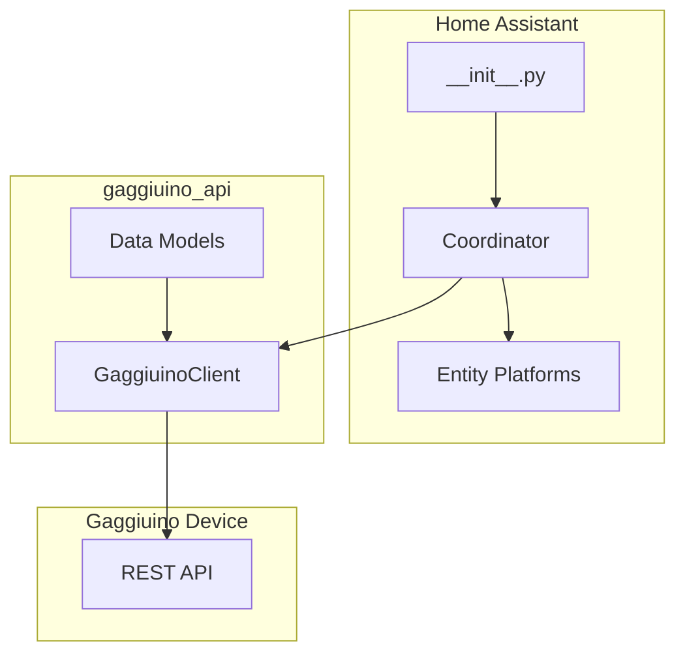

# Gaggiuino Home Assistant Integration - Agent Guidelines

## Project Overview

This is a Home Assistant custom integration for the Gaggiuino espresso machine controller. It provides sensors, binary sensors, selects, numbers, switches, and lights to monitor and control a Gaggiuino device through its API.

## Project memory

Read `.claude/memory/MEMORY.md` before each task. It holds the project memory. When a task touches a topic of an index line, read the file of that line.

## Project Structure

```
hass-gaggiuino/
├── custom_components/
│   └── gaggiuino/
│       ├── __init__.py          # Integration setup and platform registration
│       ├── binary_sensor.py     # Binary sensor entities (availability, health, switches, activity, faults)
│       ├── config_flow.py       # UI configuration flow
│       ├── const.py             # Constants (DOMAIN, CONF_PROFILE)
│       ├── coordinator.py       # Data update coordinator - fetches and caches all API data
│       ├── light.py             # LED light entity with RGB support
│       ├── manifest.json        # Integration metadata and dependencies
│       ├── number.py            # Number entities (steam set point, display brightness)
│       ├── select.py            # Select entities (profile, release channel)
│       ├── sensor.py            # Sensor entities (temperature, pressure, versions, etc.)
│       ├── switch.py            # Switch entities (LED disco, scales toggles, display dark mode)
│       └── translations/
│           └── en.json          # English translations for all entities
├── tests/                        # Tests with pytest-homeassistant-custom-component
├── blueprints/                   # Automation blueprints
├── config/                       # Development configuration
└── scripts/                      # Development scripts (develop, lint, setup)
```

## Key Dependencies

- **gaggiuino_api**: External Python package that provides the API client
- **Home Assistant Core**: Provides the base integration framework

## Architecture

### Data Flow



### Coordinator Pattern

The [`coordinator.py`](custom_components/gaggiuino/coordinator.py) is the central data hub:

1. **Data Fetching**: `_async_update_data()` sends seven GET requests, one after another, every 30 seconds: the status, the profiles, the health, the latest shot, the settings, the firmware progress and the service history (`maintenance`). It returns one frozen `GaggiuinoData` object, and the entities read `coordinator.data`.
2. **Machine off**: a connection error raises `UpdateFailed`, so each entity is unavailable. Only the Availability binary sensor stays available and shows `coordinator.last_update_success`. The setup of the entry succeeds while the machine is off.
3. **Actions**: `async_update_settings(group, **changes)` and `async_select_profile(id)` write, read back what changed, and push it into `coordinator.data`. A library error becomes `HomeAssistantError`.
4. **Lock**: the poll and each action hold one `asyncio.Lock`. The LED light and the LED disco switch are on two platforms and write one settings group, and `PARALLEL_UPDATES` orders only the actions of one platform. The lock also stops a poll that read the settings before a write from storing the old copy after it.

### Entity Pattern

All entities follow the same pattern:

```python
class GaggiuinoEntity(
    CoordinatorEntity[GaggiuinoDataUpdateCoordinator], PlatformEntity
):
    def __init__(self, coordinator: GaggiuinoDataUpdateCoordinator) -> None:
        super().__init__(coordinator)
        self._attr_unique_id = f"{coordinator.entry.entry_id}_{key}"
        self._attr_device_info = coordinator.device_info
```

## Coding Standards

### Python Style

- The code targets Python 3.14. Annotations are lazy, so do not add `from __future__ import annotations`.
- Follow Home Assistant's entity patterns
- Use dataclasses for entity descriptions. A description reads a typed field through a lambda, for example `value_fn=lambda data: data.status.up_time`.

### Entity Categories

- **EntityCategory.CONFIG**: User-configurable settings (steam set point, release channel, display brightness, switches)
- **EntityCategory.DIAGNOSTIC**: Read-only diagnostic data (versions, uptime, firmware status)

### Entity Registry Default

- Diagnostic entities: `entity_registry_enabled_default = False`, except an entity that shows a fault
- A new entity needs the choice of its default: on for a value that most users use, off for a raw or service value
- Config entities: Enabled by default (no explicit setting needed)

### Frozen Dataclasses

The API models and `GaggiuinoData` are frozen dataclasses. **Never try to modify their attributes directly.** Use `dataclasses.replace()` to make a changed copy.

### Async Patterns

- All API calls must be awaited
- The client uses the shared session of Home Assistant (`async_get_clientsession`). Do not use `async with` on the client.
- Never call async methods from properties (read `coordinator.data` instead)

## Common Tasks

### Adding a New Sensor

1. Add sensor description to `SENSORS` tuple in [`sensor.py`](custom_components/gaggiuino/sensor.py)
2. Add translation key to [`translations/en.json`](custom_components/gaggiuino/translations/en.json)
3. If data comes from a new API endpoint, update [`coordinator.py`](custom_components/gaggiuino/coordinator.py)

### Adding a New Control Entity

1. Create entity class following the pattern in existing platform files
2. Add to `async_setup_entry()` function
3. Add translation key to translations
4. Add update method to coordinator if needed

### Updating Settings

```python
# The library reads the group, lays the changes over it and sends the whole group back.
await coordinator.async_update_settings("led", disco=True)
await coordinator.async_update_settings("led", color=LedColor(r=255, g=0, b=0))
```

The names are the snake_case fields of the library model. A nested value is a model, for example `LedColor`.

## Testing

- Run the tests with `uv run pytest tests`. The test package `pytest-homeassistant-custom-component` needs `fcntl`, so the tests run only on Linux: in WSL and in CI.
- A test plays the machine with the `aioclient_mock` fixture: `FakeMachine` in `tests/conftest.py` answers each request from the saved answers in `tests/fixtures/`.
- The end-to-end tests in `tests/e2e/` (marker `e2e`) set up the integration in Home Assistant against a real machine. The `addopts` of pytest deselect them, so `uv run pytest tests` does not run them. Run them on Linux with `uv run pytest -m e2e tests/e2e`. The machine answers at `GAGGIUINO_BASE_URL` (default `http://gaggiuino.local`). The fixtures in `tests/e2e/conftest.py` let a socket connect only to the address of the machine, and give the session of Home Assistant a DNS resolver on the loop of the test.
- Safety rules of the end-to-end tests: a test writes only the `led` and `display` settings groups, and it selects only another saved profile and back. It never creates or deletes a profile, never calls the firmware update and never touches a shot. Each test that writes reads the raw state first, restores it in a `finally` block and skips when the machine brews, steams or gives hot water. A session fixture makes sure that the profiles and the `led` and `display` groups are the same after the run.
- Use `scripts/lint` to check code quality

## Related Projects

- **gaggiuino_api**: The underlying API library
- **Gaggiuino Firmware**: The device firmware that provides the REST API

## Important Notes

1. **Profile Selection**: `async_select_profile()` reads the profiles and the status again after the select, so the new profile shows at once.

2. **No refresh after a write**: do not call `async_request_refresh()` after an action. It has a cooldown of 10 seconds. The action pushes the group that it read back into `coordinator.data`.

3. **Old firmware**: a format error of the poll names the minimum firmware (`MINIMUM_FIRMWARE` of the library). The latest shot id alone is optional: its error gives `None`.

4. **Device card**: `coordinator.device_info` has the firmware version (`core_version`) and the board type (`core_type`) of the status, once the coordinator has data.

5. **Left-out fields**: `UNSUPPORTED.md` names each field that the integration does not make an entity of, with its reason. Keep it in step with the entities.

6. **Platform Registration**: New platforms must be added to `PLATFORMS` list in [`__init__.py`](custom_components/gaggiuino/__init__.py).
