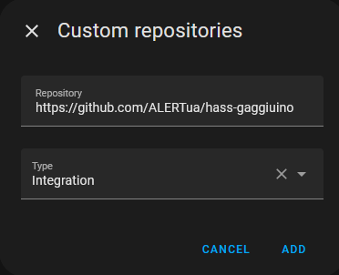
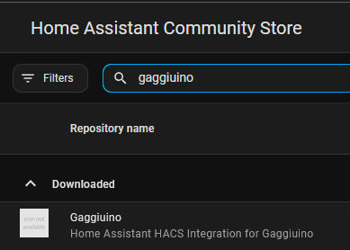
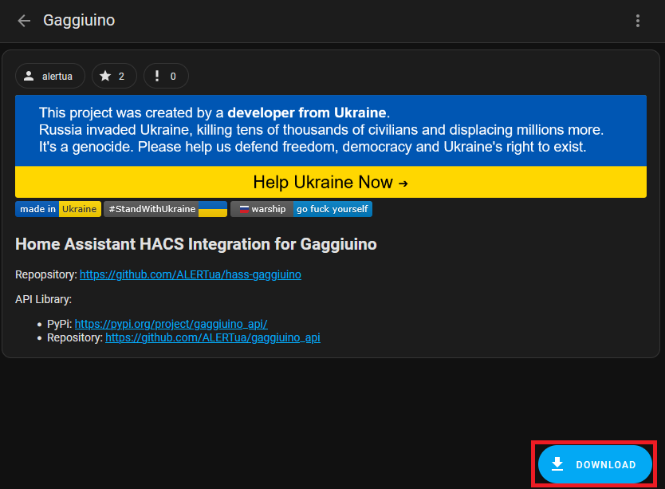
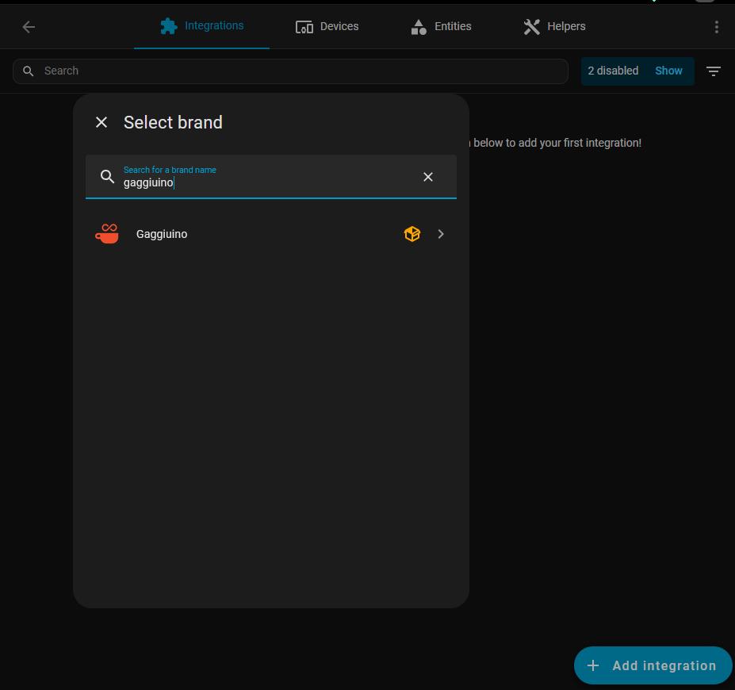
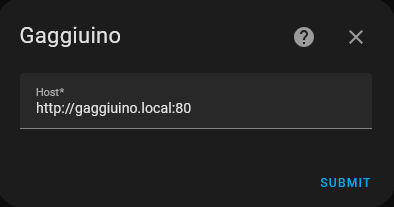
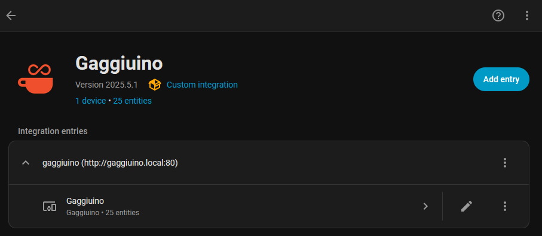
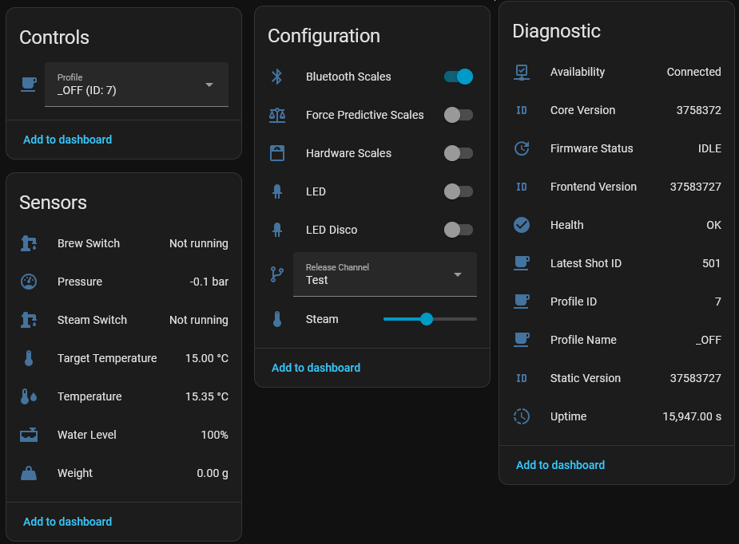

[](https://stand-with-ukraine.pp.ua)
[](https://stand-with-ukraine.pp.ua)
[](https://stand-with-ukraine.pp.ua)
[](https://stand-with-ukraine.pp.ua)

[](https://github.com/ALERTua/hass-gaggiuino)
[](https://my.home-assistant.io/redirect/hacs_repository/?owner=ALERTua&repository=hass-gaggiuino&category=Integration)
[](https://github.com/ALERTua/hass-gaggiuino/actions/workflows/validate.yml)
[](https://github.com/ALERTua/hass-gaggiuino/releases)


Home Assistant HACS Integration for Gaggiuino
---------------------------
Repository: https://github.com/ALERTua/hass-gaggiuino

Gaggiuino Repository: https://github.com/Zer0-bit/gaggiuino/releases

Blueprints Readme: [link](/blueprints/BLUEPRINTS.md)

API Library:
- PyPi: https://pypi.org/project/gaggiuino_api/
- Repository: https://github.com/ALERTua/gaggiuino_api

# Table of Contents
1. [Requirements](#requirements)
2. [Installation](#installation)
3. [Entities](#entities)
4. [Troubleshooting](#faq--troubleshooting)
5. [Blueprint Library](/blueprints/README.md)

## Requirements

- Gaggiuino firmware [`c929939`](https://github.com/Zer0-bit/gaggiuino/releases/tag/main-c929939) or newer. An older firmware answers in a format that this version does not support, and the integration names the minimum firmware in its error.
- Home Assistant `2026.3.0` or newer.

## Installation

[](https://my.home-assistant.io/redirect/hacs_repository/?owner=ALERTua&repository=hass-gaggiuino&category=Integration)
<details><summary> Adding the integration to HACS manually </summary>

1. Add HACS Custom Repository for this project



2. The integration can now be found in the HACS Community Store



3. Open the integration in the HACS Community Store
and download it using the corresponding button in the lower right corner.



4. Restart your Home Assistant

</details>

### Adding the integration to Home Assistant

<details><summary> Adding the integration to Home Assistant </summary>

5. Open your Settings→Devices&Services, press Add Integration button in the lower right corner,
search for this integration, and select it.



</details>

## Integration setup

Home Assistant finds the machine by itself when the machine announces itself on the network (mDNS). The machine then shows under the discovered devices in Settings→Devices&Services, and you only confirm it. Discovery needs mDNS to reach Home Assistant, so a container without the host network does not get it. You can always add the machine by hand:

1. Enter your Gaggiuino web address



Integration setup complete. Your Gaggiuino is now available as a device.





## Entities

The integration makes these entities for the machine. An entity that is off by default is hidden from the start. To use it, open the entity in Home Assistant and turn it on. The Energy sensor is an estimate that the machine makes, not a meter. The fields that the integration leaves out on purpose are in [UNSUPPORTED.md](UNSUPPORTED.md).

The firmware can announce its own entities to Home Assistant over MQTT. If that MQTT discovery is on, both devices have the name Gaggiuino, and some entities of the two devices want the same entity id. The entity that reserves the id second gets `_2` at the end, for example `sensor.gaggiuino_boiler_temperature_2`. So the setup that you add later gets the suffix, the MQTT discovery or this integration. You can rename such an entity, or disable the copy that you do not need.

### Sensors

| Entity | What it shows | On by default |
|---|---|---|
| Uptime | The time since the machine started | no |
| Profile ID | The id of the active profile | yes |
| Profile Name | The name of the active profile | yes |
| Latest Shot ID | The id of the latest shot | no |
| Target Temperature | The target temperature of the boiler | yes |
| Temperature | The measured temperature of the boiler | yes |
| Pressure | The measured pressure | no |
| Water Level | The water level of the tank | yes |
| Weight | The weight on the scales | no |
| Core Version | The version of the core firmware | no |
| Frontend Version | The version of the frontend firmware | no |
| Static Version | The version of the static web assets | no |
| Firmware Status | The state and the progress of a firmware update | no |
| Operation Mode | What the machine does now, for example brew, steam or flush | yes |
| Power | The estimated power that the machine uses now | yes |
| Energy | The estimated total energy use of the machine | no |
| Session Energy | The estimated energy use since the last power cycle | no |
| Pump Flow | The flow of the pump | no |
| Weight Flow | The change of the weight per second | no |
| Warmup Remaining | The time until the warmup ends | yes |
| Warmup Elapsed | The time since the warmup started | no |
| Boiler Temperature | The temperature of the boiler, as the machine reports it | yes |
| Readiness State | The raw readiness state of the machine | no |
| Core Type | The board type of the machine | no |
| Power Line Frequency | The frequency of the mains power | no |
| Machine Name | The name that you gave the machine | no |
| Last Descale | The time of the last descale | yes |
| Shots Since Descale | The number of shots since the last descale | yes |
| Last Backflush | The time of the last backflush | yes |
| Shots Since Backflush | The number of shots since the last backflush | yes |

The two time sensors show unknown when the machine never recorded the event.

### Binary sensors

| Entity | What it shows | On by default |
|---|---|---|
| Availability | The last poll got an answer from the machine | yes |
| Health | The machine reports a problem | yes |
| Brew Switch | The state of the brew switch | yes |
| Steam Switch | The state of the steam switch | yes |
| Brewing | The machine brews | yes |
| Steaming | The machine makes steam | no |
| Hot Water | The machine gives hot water | no |
| Boiler Heating | The boiler relay is on | no |
| Scales | Scales are connected | no |
| Thermocouple Fault | The thermocouple cannot be read. The attribute `reason` has the cause | yes |
| Pressure Sensor Fault | The pressure sensor cannot be read. The attribute `reason` has the cause | yes |
| Steam Left On | The steam switch was left on | yes |
| Brew Valve | The brew valve is open | no |
| Steam Valve | The steam valve is on | no |
| Valve B | The valve that routes the boiler to the group or the tank is open | no |
| Steam Boiler Relay | The steam boiler relay is on | no |
| Tare Pending | A tare of the scales waits to complete | no |
| Water Level Sensor Ready | The water level sensor is ready | no |
| Startup Finished | The startup of the machine is complete | yes |
| Brew Switch Active | A brew switch flag that the machine sends | no |

### Controls

| Entity | What it does | On by default |
|---|---|---|
| Profile | Selects the active profile | yes |
| Release Channel | Selects the release channel of the firmware updates | yes |
| LED | Turns the LED on or off and sets its color | yes |
| LED Disco | Turns the disco mode of the LED on or off | yes |
| Steam | Sets the steam set point | yes |
| Force Predictive Scales | Turns the predictive scales on or off | yes |
| Hardware Scales | Turns the hardware scales on or off | yes |
| Bluetooth Scales | Turns the Bluetooth scales on or off | yes |
| Display Brightness | Sets the brightness of the screen, from 0 to 100 percent | yes |
| Display Dark Mode | Turns the dark mode of the screen on or off | yes |

## FAQ / Troubleshooting

**Q: `ERROR (MainThread) [custom_components.gaggiuino.coordinator] Error fetching gaggiuino data: Unhandled exception`**

**A:** Make sure you are on the latest firmware; make sure API Endpoints are available for Home Assistant.
E.g. http://gaggiuino.local/api/system/status


**Q: Why are all entities unavailable?**

**A:** The machine is off or does not answer. While the machine does not answer, each entity is unavailable, except the Availability binary sensor. The Availability sensor shows the connection: it is on when the last poll got an answer and off when it did not. When the machine answers again, the entities get their values at the next poll.


**Q: The states get updated only this frequently.**

**A:** Home Assistant integrations have a fixed update period. This one is fixed at 30 seconds. Due to this long refresh period, the integration can not be used to monitor shots.


**Q: Why do the profiles have their IDs in the Profile Selector?**

**A:** While the Gagguino Profile IDs are unique, their names are not, you can have multiple profiles with the same name, but their IDs will be different. The profile selection method calls for a profile ID to be provided, that's why I decided to visually represent the selector items as both Profile Names and their corresponding IDs. I know this is not very convenient in automation, but I am open to your ideas.
```yaml
action: select.select_option
target:
  entity_id: select.gaggiuino_profile
data:
  option: "OFF (ID: 7)"
```

#### Note: I always implement features from the latest Gaggiuino Releases. Please make sure your machine is on the latest firmware available.

You can always find me on the official Gaggiuino Discord.

Feel free to post your automations in https://github.com/ALERTua/hass-gaggiuino/discussions/categories/ideas

I will gather the most valuable posts in a pinned one.

❤️
